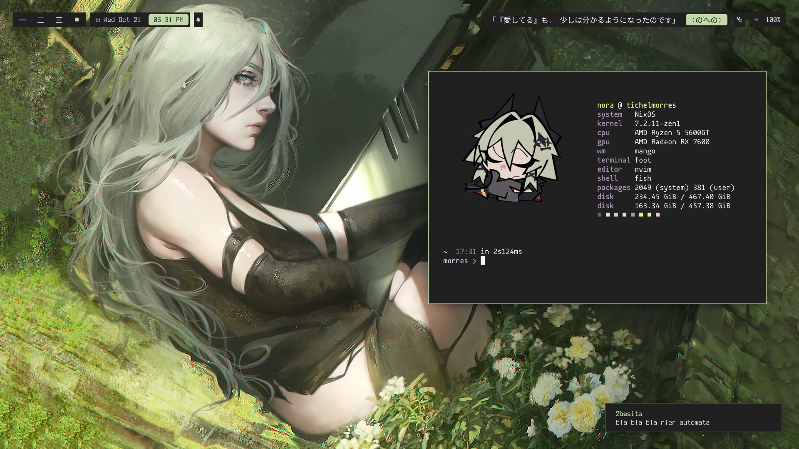
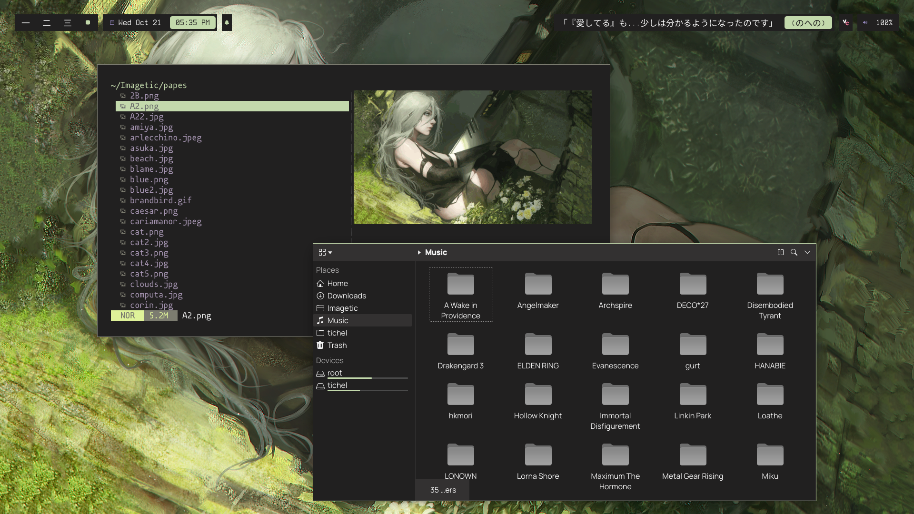
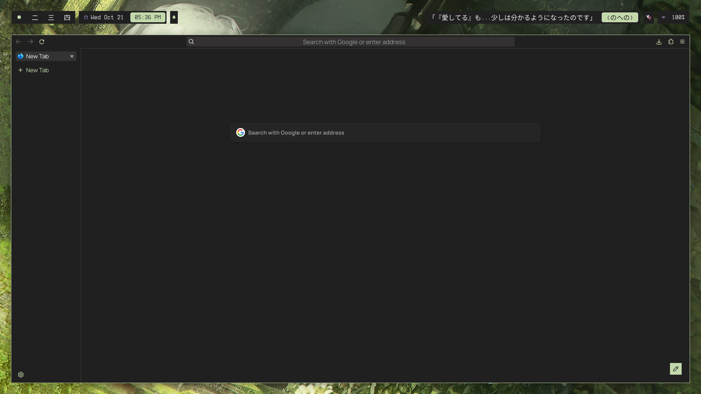
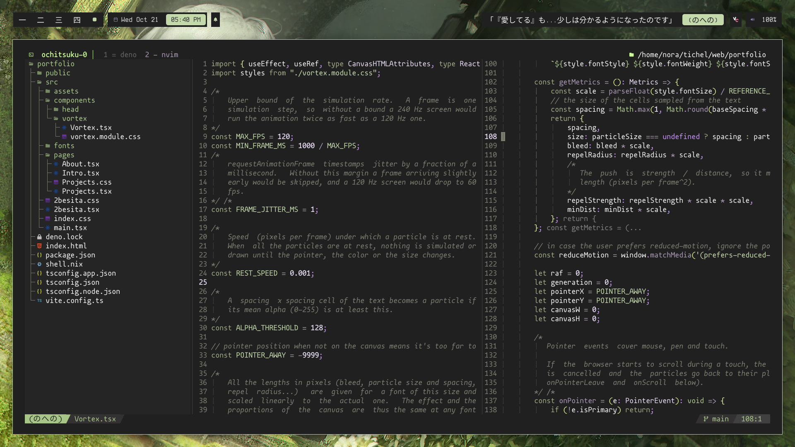
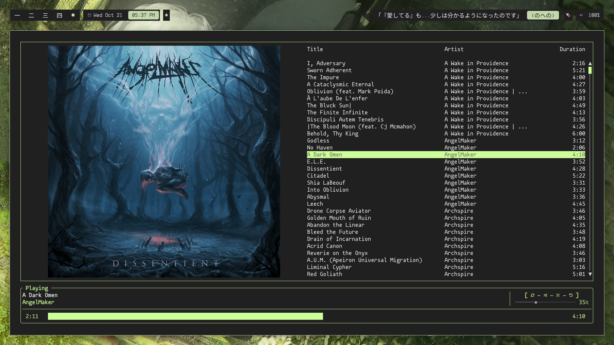
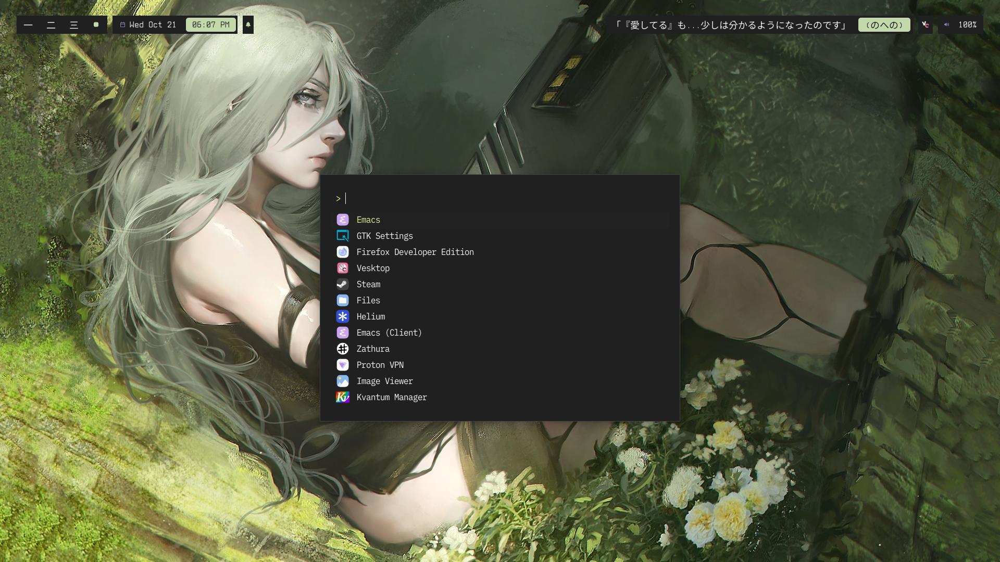
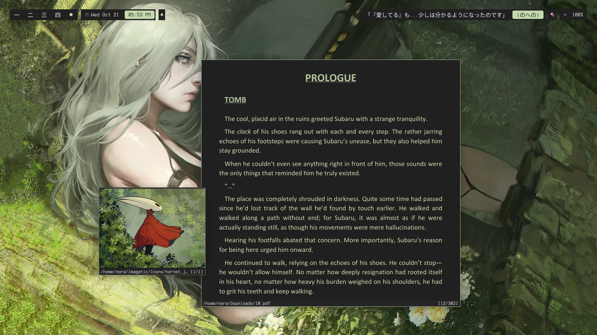

Personal dotfiles for MangoWM and a bunch of applications

### Applications:

<samp>
compositor: mangowm 
top bar: waybar 
notifications: dunst 
terminal: foot 
terminal stuff: starship, fastfetch, tmux 
shell: fish 
browser: firefox 
editor: neovim 
application launcher: fuzzel 
pdf and image viewer: zathura 
music player: rmpc 
 
 

wallpaper daemon: awww 
terminal font: Mononoki Nerd Font Mono 
waybar, dunst, etc: Terminess Nerd Font Mono 
firefox: Manrope 
[neovim theme](https://github.com/2besita/echidna.nvim.git) 

(Scripts you see on mango keymaps are not mine, the owner asked me to not add them here :p) 
</samp>

### Showcase

